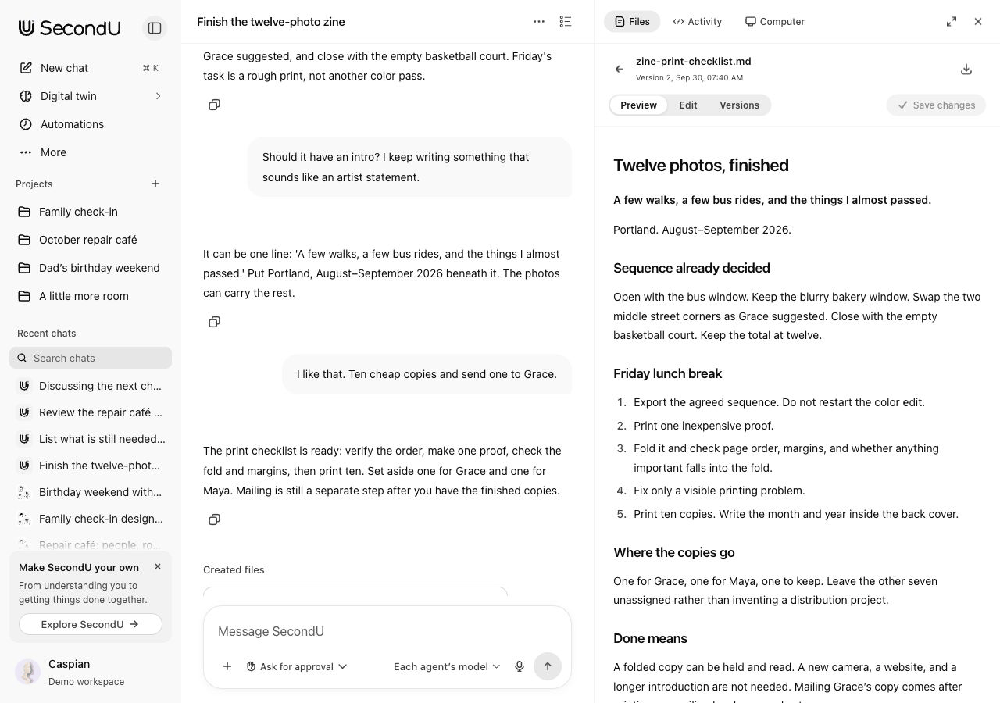
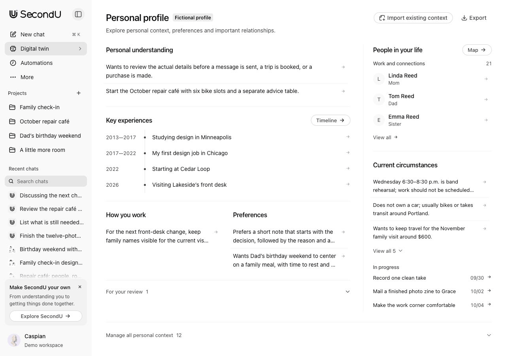
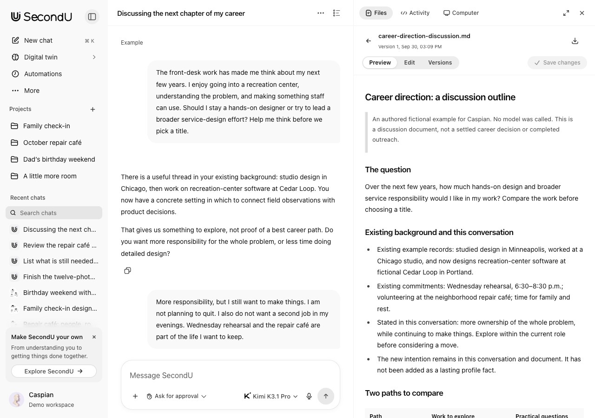
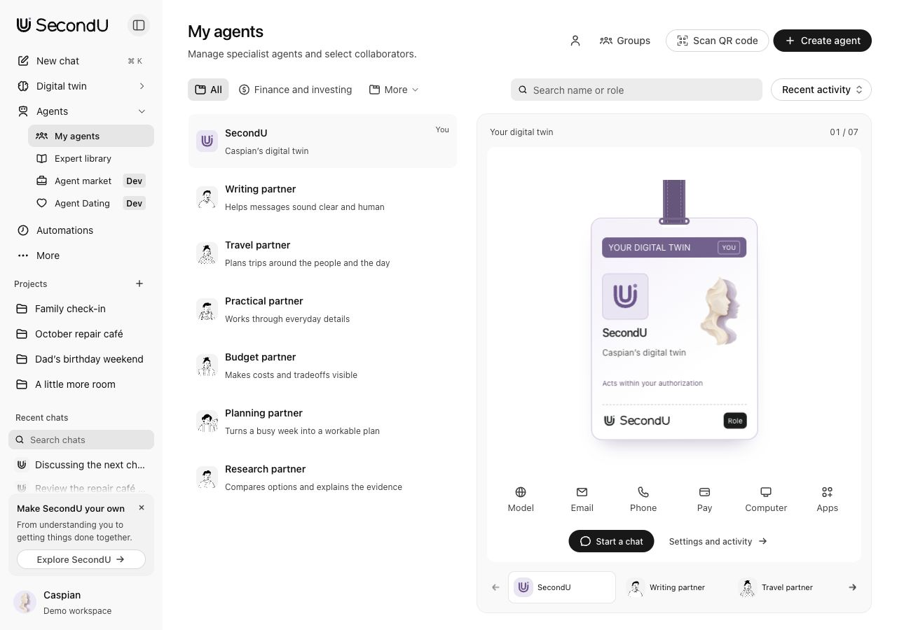
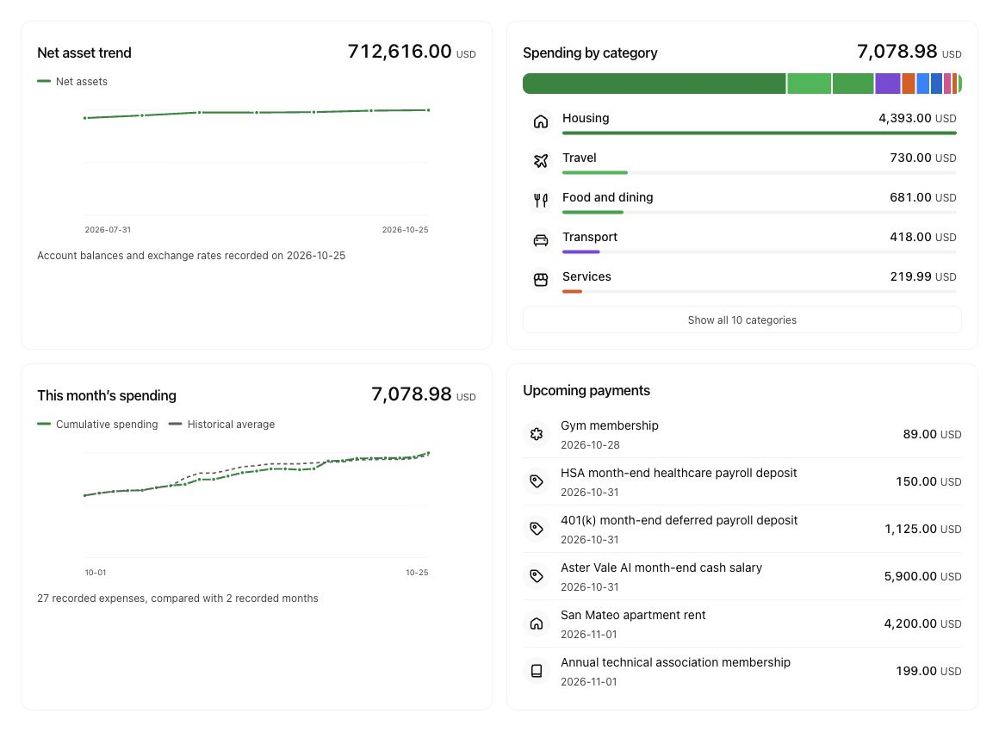
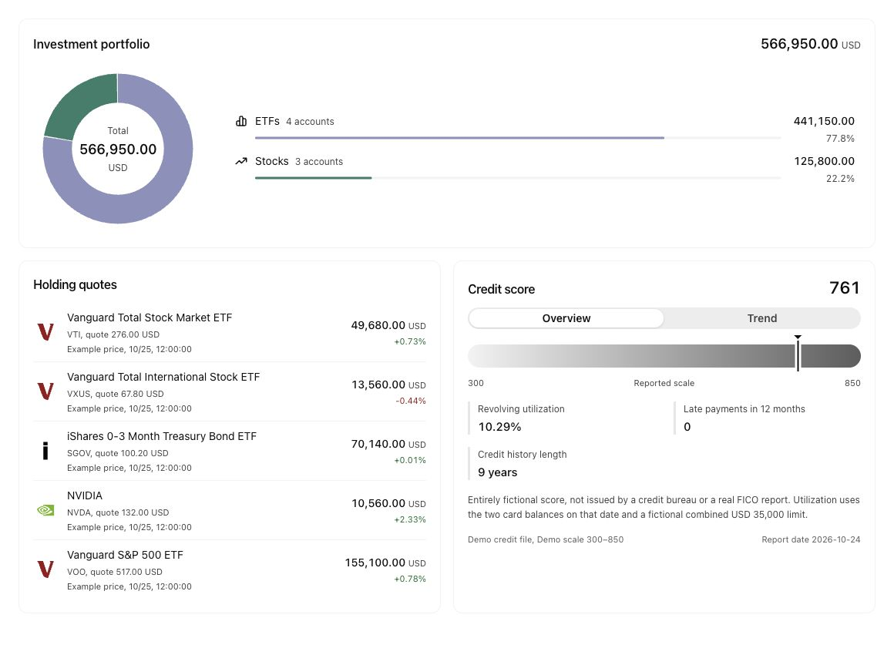

<p align="center">
  <a href="https://secondu.ungetsu.net/?lang=en"></a>
</p>
<h1 align="center">SecondU</h1>
<p align="center"><strong>Your digital twin.</strong><br>From understanding to action.</p>
<p align="center">An open-source agent product built around a personal digital twin.</p>
<p align="center">
  <a href="https://secondu.ungetsu.net/product/embed.html?space=demo-us-v1&lang=en#example-chat"><strong>Try SecondU</strong></a>&nbsp;&nbsp;&nbsp;
  <a href="https://github.com/YunyueLi/SecondU/releases/tag/v0.2.1"><strong>Download for macOS</strong></a>&nbsp;&nbsp;&nbsp;
  <a href="QUICKSTART.md">Quick start</a>&nbsp;&nbsp;&nbsp;
  <a href="https://secondu.ungetsu.net/benchmark/?lang=en">Benchmark</a>&nbsp;&nbsp;&nbsp;
  <a href="README.zh-CN.md">简体中文</a>
</p>
<p align="center">
  <a href="https://github.com/YunyueLi/SecondU/actions/workflows/ci.yml"></a>
</p>

<p align="center">
  <a href="https://secondu.ungetsu.net/product/embed.html?space=demo-us-v1&lang=en#example-chat">
    <picture>
      <source media="(prefers-reduced-motion: reduce) and (prefers-color-scheme: dark)" srcset="docs/readme-assets/task-workspace-en-dark.jpg">
      <source media="(prefers-reduced-motion: reduce)" srcset="docs/readme-assets/task-workspace-en.jpg">
      <source media="(prefers-color-scheme: dark)" srcset="docs/readme-assets/task-workspace-en-dark.gif">
      
    </picture>
  </a>
</p>

<p align="center"><sub>Actual application states with fictional example data. <a href="https://secondu.ungetsu.net/product/embed.html?space=demo-us-v1&lang=en#example-chat">Try the app</a> without an account or model key, or visit the <a href="https://secondu.ungetsu.net/?lang=en">product website</a>.</sub></p>

## Understanding that carries forward

**SecondU is an open-source agent product built around a personal digital twin.**

SecondU develops an understanding of your background, experiences, values, preferences, relationships and long-term goals, and carries it across tasks, situations and devices. It connects scattered multimodal information, brings in experts and tools, and turns ideas into action, collaboration, social connections and professional services.

That product direction has three priorities:

- **Explain less, carry more forward.** Keep background and decisions with inspectable sources and correctable interpretations.
- **Keep context connected.** Carry multimodal materials, tasks and results across devices.
- **Share expertise on your terms.** Authorize a limited professional twin for collaboration, social connections and A2A services.

The **runnable desktop prototype** establishes this foundation. Cross-device continuity and the broader service network remain development directions. [Vision and roadmap](docs/ROADMAP.md)

## From personal context to useful work

### Grow your twin from one piece of material

The **Grow your twin** workspace brings together seven entry points: **existing sources, text and notes, photos and videos, conversations, existing memory, connected sources, and your own thoughts**. Existing materials stay in the same library, with connected services managed from the connection entry.

For direct input, choose **Help understand me** or **Only this time**. In personal space, submitting saves the material and starts processing when a model and local runtime are configured; otherwise, it saves the material for later. Other imports preserve originals first, and you start processing from the source details. Photos and videos share the library, with storage and playback for your original media.

**Save material → model processing → your review → a new task draft.** Suggested facts, people and experiences include their evidence. Accept, correct or skip each item. Confirmed personal material joins your records; session-only material keeps its processing and review history outside your long-term profile. Failures retain the material and reason, and retries are explicit.

### Bring personal understanding into a task

Your profile, timeline, relationships and sources make understanding inspectable and correctable. Choose context for a task and check what was actually used. Reviewed understanding can become an editable task draft that you finish and send. For work, learning or life choices, use your experiences, preferences and current constraints to discuss trade-offs. The decision remains yours. [Follow the five-minute walkthrough](docs/PROTOTYPE.md#连接模型后五分钟验证主线), or inspect the [synthetic context comparison](docs/CONTEXT-BENCHMARK.md).

<p><a href="https://secondu.ungetsu.net/product/embed.html?space=demo-us-v1&lang=en#self"><picture>
      <source media="(prefers-reduced-motion: reduce) and (prefers-color-scheme: dark)" srcset="docs/readme-assets/personal-context-en-dark.jpg">
      <source media="(prefers-reduced-motion: reduce)" srcset="docs/readme-assets/personal-context-en.jpg">
      <source media="(prefers-color-scheme: dark)" srcset="docs/readme-assets/personal-context-en-dark.gif">
      
    </picture></a></p>

### Think through an important choice

[Open the career discussion example](https://secondu.ungetsu.net/product/embed.html?space=demo-us-v1&lang=en#example-decision) to see how experience, working preferences and life outside work inform a comparison of possible directions. Four exchanges and an editable outline live in the real task workspace.

<p><a href="https://secondu.ungetsu.net/product/embed.html?space=demo-us-v1&lang=en#example-decision"><picture>
      <source media="(prefers-color-scheme: dark)" srcset="docs/readme-assets/decision-support-en-dark.jpg">
      
    </picture></a></p>

### Bring the right expertise and tools together

Talk to a specialist or form a team with a lead. Follow delegated work, status and results. Project directories, model connections and approvals define the working environment.

<p><a href="https://secondu.ungetsu.net/product/embed.html?space=demo-us-v1&lang=en#agents"><picture>
      <source media="(prefers-color-scheme: dark)" srcset="docs/readme-assets/specialists-en-dark.jpg">
      
    </picture></a></p>

### Keep finances in view

The Finance workspace brings together **overview, accounts, holdings, market data, liabilities, transactions and planning**. Record cash, investments and other asset types; retain original currencies and observation dates; inspect exchange-rate conversions and the difference between recorded balances and quote-based estimates. Customize 13 overview components, record transactions manually or import a CSV, and manage bills, subscriptions, budgets, savings goals, credit records, weekly reports and planning scenarios. Selected records can accompany a question as an inspectable context snapshot. [Finance guide](docs/FINANCE.md)

Choose an account provider in **Settings → Connectors**, preview your accounts and match them to your records before synchronizing. Browse financial research services in the same directory.

The [website's finance story](https://secondu.ungetsu.net/?lang=en#finance) brings retirement savings, employer stock, foreign-currency assets, everyday spending and long-term plans together in one bilingual example.

Explore six views: **Overview, Portfolio, Structure, Allocation, Details and Holdings**. Overview brings together net assets, spending categories, monthly spending and upcoming payments; Portfolio combines investments, holding quotes and a recorded credit score. Open the full workspace from any preview without losing your place on the website. Quote timestamps use the example's Pacific time zone, with the actual zone available in the full timestamp.

<p><a href="https://secondu.ungetsu.net/product/embed.html?space=demo-us-v1&lang=en#finance"><picture>
      <source media="(prefers-color-scheme: dark)" srcset="docs/readme-assets/finance-overview-en-dark.jpg">
      
    </picture></a></p>

<p><a href="https://secondu.ungetsu.net/product/embed.html?space=demo-us-v1&lang=en#finance"><picture>
      <source media="(prefers-color-scheme: dark)" srcset="docs/readme-assets/finance-portfolio-en-dark.jpg">
      
    </picture></a></p>

### Choose how the workspace fits your work

The ten-chapter product guide now includes dedicated **Finance** and **Workspace setup** chapters, with direct entry points into these new features.

Pin **Finance, Agents and Library** in the sidebar and expand the Finance and Agents sections as needed. Home suggestions provide starting points for a task. The connector directory separates available tools, financial account providers and research sources. **Settings → Computer** shows local runtime availability and manages SSH computers; task drafts can select a configured execution computer. Appearance settings bring together language, theme, backgrounds and motion preferences.

### Keep working with the result

Edit files beside the conversation, save versions and revisit earlier content. Revising a sent question creates a new branch; the original discussion and feedback remain available.

| Also included | Current capability |
| --- | --- |
| Personal finance | Accounts, assets, holdings, quotes, spending and planning; manual/CSV records and supported read-only provider connections. [Details](docs/FINANCE.md) |
| Execution computers | Check local runtimes, manage SSH computers and choose the execution computer for each task. |
| Files and previews | Markdown, code, tables, static HTML/SVG, images and PDF. Office originals are preserved, with optional local LibreOffice PDF previews. |
| Messaging | OpenClaw setup for 13 channels. Slack/Discord history import and confirmed sending, with explicit account and conversation scope. |
| Context for other AI apps | Versioned context exports and explicitly authorized read-only MCP snapshots. [Interoperability](docs/INTEROPERABILITY.md) |
| Projects and routines | Project materials, directories, goals and locally scheduled tasks. |
| Limited capability sharing | Local text delegation and an A2A subset, with scoped authorization, approval and revocation. [Scope](docs/DELEGATION.md) |
| A workspace you can inspect | Bilingual examples, themes, a component catalogue and an updateable development timeline. |

### Continue when relevant material changes

Enable **Let my twin contact me** in settings to consider new or updated sources in the current local space alongside active work. A read-only model evaluation prepares a sourced analysis, draft or judgment before deciding whether a new contribution belongs in a normal, replyable conversation. Enable it while the local service is running. [Proactive contact](docs/PROACTIVE_CONTACT.md)

### Continue on a smaller screen

The mobile entry reuses the same sources, twin-building flow and task components to view material, review understanding and continue conversations. It is available in the local browser; connecting an actual phone requires a separately configured private connection.

## Personal-context benchmark

[**Explore the interactive benchmark**](https://secondu.ungetsu.net/benchmark/?lang=en): **24 authored synthetic cases, six dimensions, three context conditions and two repetitions — 144 planned calls, 143 returned.** The page lets you inspect each case, repetition, exact input, original reply, source and failure. [Method and reproduction](docs/CONTEXT-BENCHMARK.md) · [Frozen plan and evidence](benchmarks/results/2026-10-01-v2/)

The primary comparison uses the same model and an 8,000-character context cap. Raw-record retrieval uses BM25; SecondU uses its production confirmation, revision and context-selection path.

| Prespecified check | Raw-record retrieval | SecondU context |
| --- | ---: | ---: |
| Both repetitions correct, per case | 24 / 24 | 21 / 24 |
| Expected decision or clarification, per call | 48 / 48 | 43 / 48 |
| Hard constraints met, where applicable | 36 / 36 | 32 / 36 |
| Required source coverage, where applicable | 40 / 40 | 36 / 40 |

**What needs work:** SecondU missed required sources in H03 and H04. All four replies appropriately asked for clarification, but failed the end-to-end decision requirement. R04's second SecondU call timed out after 180 seconds and was not retried. All five cases remain in the reported totals.

No-context is a separate visible-information calibration: **47 / 48** calls met its requirements; one returned truncated JSON, preserved without repair. The run evaluates one model on synthetic, author-confirmed records, measuring decisions and source use across the stated scenarios. The [12-call historical baseline](benchmarks/results/2026-10-01/) and [12-call pilot](benchmarks/results/2026-10-01-v2/pilot/) remain separate from formal results.

## Get started

| Start here | What to expect |
| --- | --- |
| **[Try it in your browser](https://secondu.ungetsu.net/product/embed.html?space=demo-us-v1&lang=en#example-chat)** | Explore bilingual examples, import a summary and edit content in the current page. Reload to start again. |
| **[Download the desktop app](https://github.com/YunyueLi/SecondU/releases/tag/v0.2.1)** | Apple Silicon Mac, macOS 13+. Includes Node. See the quick start for installation. |
| **Run from source** | Node.js 22.18+ and npm. Use the commands below, then open [localhost:58645](http://127.0.0.1:58645). |

```sh
git clone https://github.com/YunyueLi/SecondU.git
cd SecondU
npm ci
npm run build
npm start
```

Choose an example space to explore without credentials. To run real tasks, enter personal space, install **Codex CLI** separately and configure your own model connection. [Setup and troubleshooting](QUICKSTART.md)

## Your data, your permissions

Records and file history stay local, separate from examples. You choose the model and task context. **Cloud models receive selected context and bounded source excerpts.**

The API is loopback-only; credentials are stored separately with restricted permissions. Tools and sharing have explicit scopes. [Security](SECURITY.md) and [backup](QUICKSTART.md#data-paths-and-environment)

## Where the product is going

The [12-direction roadmap](docs/ROADMAP.md) describes current foundations, next steps and the conditions for accepting each capability.

| Direction | Areas |
| --- | --- |
| A lasting personal foundation | Understanding the person; work and life assistance; proactive, ongoing responsibilities |
| Work that can continue | Specialist teams; projects and deliverables; local and remote execution |
| Context beyond one screen | Communication and real-world resources; multimodal continuity across devices; authorized expertise distribution |
| A network built around people | A2A collaboration and service transactions; social and relationship discovery; continuously improving personal assets |

**Latest release:** [v0.2.1](docs/releases/v0.2.1.md) adds the Finance workspace, configurable sidebar modules, local/SSH computer settings, an expanded connector directory, home suggestions and appearance refinements. Desktop releases support macOS arm64. [Product walkthrough](docs/PROTOTYPE.md)

## How it works

[](https://secondu.ungetsu.net/architecture/understanding-loop-en.html)

[Explore the understanding loop](https://secondu.ungetsu.net/architecture/understanding-loop-en.html)

[Explore the execution architecture](https://secondu.ungetsu.net/architecture/harness-en.html)

**React and official OpenAI Apps SDK UI** power the interface; **Node.js and SQLite** persist state. **Codex CLI app-server** supplies execution. SecondU adds context, task and team orchestration, permissions and versioned files.

[Harness architecture](docs/HARNESS.md) and [API reference](docs/API.md) explain the execution and persistence contracts.

## Build with us

Run `npm run server` and `npm run dev` in separate terminals. Check with `npm test` and `npm run build`; verify interface changes on the actual screen.

Contribute to context quality, recovery, files, accessibility or integrations. Read [Contributing](CONTRIBUTING.md) and use fictional data in reports.

<details>
<summary><strong>Source map and documentation</strong></summary>

| Explore the source | Responsibility |
| --- | --- |
| [`src/`](src/) | Product interface and shared visual system |
| [`server/`](server/) and [`shared/`](shared/) | Storage, runtime orchestration, APIs and contracts |
| [`desktop/`](desktop/) | Electron application and macOS packaging |
| [`website/`](website/) | Product website and isolated interactive example |
| [`tests/`](tests/) | State, permissions, protocol and regression checks |

| Read next | Purpose |
| --- | --- |
| [Product walkthrough](docs/PROTOTYPE.md) | Follow a complete example and review current scope |
| [Design](docs/DESIGN.md) and [Research](docs/RESEARCH.md) | Visual language and design decisions |
| [Testing](docs/TESTING.md) and [Development](docs/DEVELOPMENT.md) | Verification guidance and implementation evidence |
| [Changelog](CHANGELOG.md) and [Iterations](docs/ITERATION.md) | User-visible changes and decisions over time |

</details>

## License

Project code is [MIT licensed](LICENSE); third-party assets retain their [own licenses](THIRD_PARTY_NOTICES.md). SecondU is independent of OpenAI and model providers. **Hither** remains in legacy identifiers and data paths.

<p><sub><a href="https://secondu.ungetsu.net/?lang=en">Move your cursor to discover the 2ndU hidden on the homepage.</a></sub></p>
